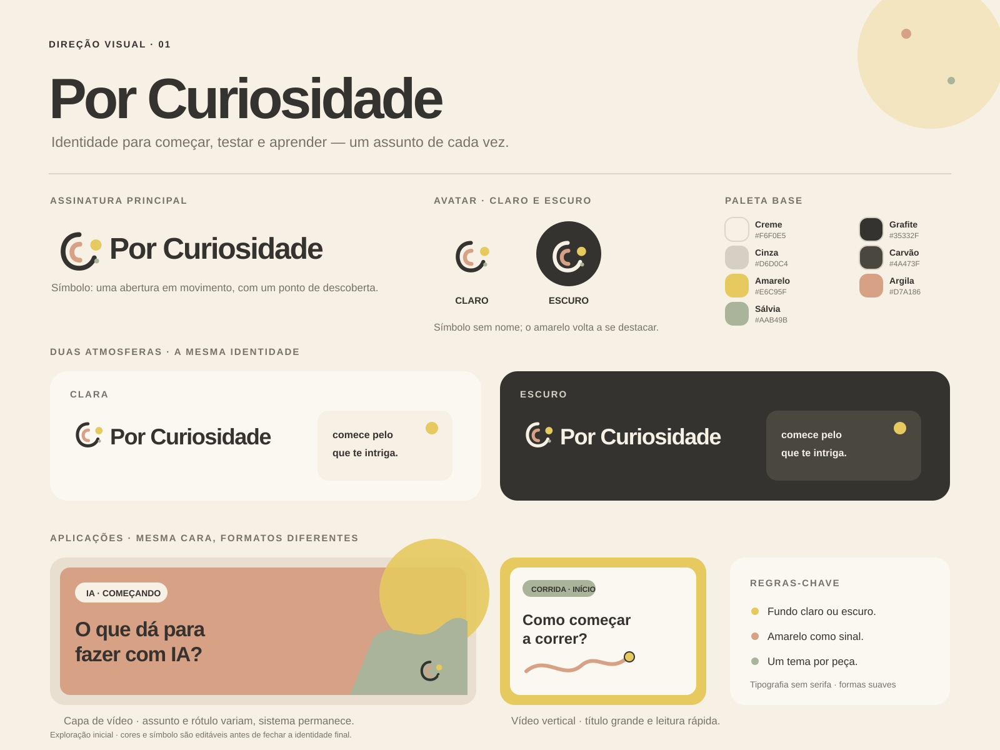

# Identidade Visual

- Identidade clean, moderna, acolhedora e levemente lúdica.
- Paleta pastel enxuta:
	- Principal: creme `#F6F0E5` (light) e grafite `#35332F` (dark)
	- Auxiliar: cinza `#D6D0C4` (light) e carvão `#4A473F` (dark)
	- Destaque: amarelo `#E6C95F`
	- Secundárias: argila `#D7A186`e sálvia `#AAB49B`
- Tipografia sem serifa, legível, com formas amigáveis.
	- Fonte: Nunito
- Logo com nome e símbolo abstrato de abertura/descoberta; símbolo deve funcionar sozinho como avatar.
- Formas geométricas suaves e poucos elementos, com bastante espaço livre.
- Marcadores discretos por tema; imagens específicas de cada conteúdo dentro de molduras e layouts consistentes.

